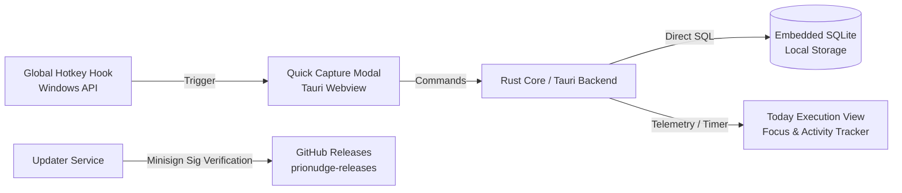
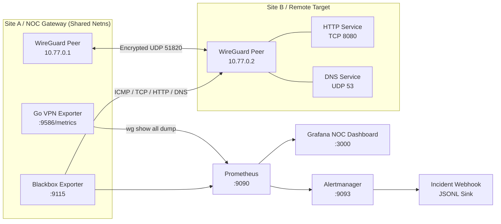
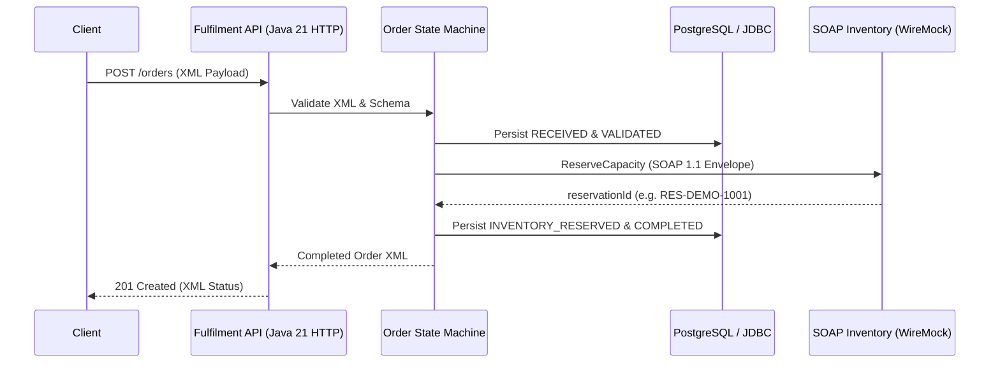
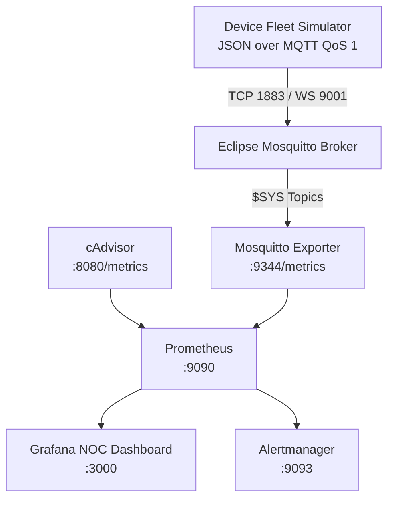

# Featured Engineering Projects & Labs

Detailed technical architecture, implementation evidence, and operational workflows for selected projects by [Izzaldin Samir](https://github.com/IzzaldinSamir).

---

## 🎯 PrioNudge — Windows Productivity & Task Manager

- **Product Site:** [prionudge.com](https://prionudge.com/)
- **Release Repository:** [`IzzaldinSamir/prionudge-releases`](https://github.com/IzzaldinSamir/prionudge-releases)
- **Landing Site Repository:** [`IzzaldinSamir/prionudge-site`](https://github.com/IzzaldinSamir/prionudge-site)
- **Primary Technologies:** Tauri v2, Rust, SQLite, TypeScript, Tailwind CSS

### Architecture & Technical Details

PrioNudge is a local-first, keyboard-centric Windows desktop task manager engineered around the **Decide → Capture → Do → Track** execution cycle.

- **Local-First Embedded Storage:** Uses an embedded SQLite database (`rusqlite`) residing on the local filesystem. All task entities, priority queues, and historical activity metrics persist locally without requiring cloud synchronization, ensuring instantaneous search and sub-millisecond query execution.
- **Global Quick Capture:** Low-latency system-wide keyboard hook implemented through Tauri's event loop to summon an unobtrusive capture dialog from any active application.
- **Structured Daily Execution ("Today" View):** Implements an active task execution interface with dedicated focus timers, target tracking, daily duration quotas, and streak counters.
- **System Tray Lifecycle & Window Management:** Integrated system tray controls with quick-toggle actions, minimizing to notification area and restoring window focus without desktop clutter.
- **Secure Packaging & Updates:** Distributes verified x64 Windows packages via NSIS installers (`.exe`) and WiX MSI installers (`.msi`). Automated updates verify payload authenticity using Tauri Minisign cryptographic signatures (`.sig`) checked against `latest.json` metadata on GitHub Releases.
- **Commercial & Privacy Model:** Designed as a privacy-respecting utility featuring a 14-day fully-featured local trial and perpetual Founder Early Access licensing; requires zero account creation or telemetry tracking.

---

## 🔐 VPN NOC Operations Lab — Site-to-Site Encrypted Infrastructure

- **Repository:** [`IzzaldinSamir/vpn-noc-operations-lab`](https://github.com/IzzaldinSamir/vpn-noc-operations-lab)
- **Primary Technologies:** WireGuard, Linux (Docker/WSL2), Go 1.24, Prometheus, Alertmanager, Grafana, Blackbox Exporter

### Architecture & Technical Details

A production-style network operations laboratory built around an encrypted site-to-site WireGuard tunnel, pairing low-level kernel telemetry with multi-protocol synthetic probes and automated triage workflows.

- **Shared Network Namespace Topology:** Deploys two Linux VPN peers (`10.77.0.1` and `10.77.0.2`) communicating over UDP 51820. `site-a`, the custom Go exporter, and the Blackbox Exporter share an identical Linux network namespace, enabling synthetic probes to traverse the real `wg0` routing table and interface counters.
- **Custom Go Telemetry Exporter (`cmd/vpn-exporter`):** Written in Go 1.24, parses low-level `wg show all dump` outputs into Prometheus gauge and counter metrics, exposing interface status, peer public keys, handshake timestamps, and cumulative ingress/egress byte streams.
- **Multi-Protocol Synthetic Probing:** Blackbox Exporter continuously evaluates tunnel health via synthetic ICMP echo, TCP connect (port 8080), HTTP endpoint validation, and DNS resolution over UDP 53.
- **Alert Correlation & Evidence Sink:** Configured with 9 Prometheus alert rules covering 6 failure domains (interface availability, handshake age, path latency, TCP listener health, HTTP status, and DNS integrity). Alertmanager routes alerts to a custom incident webhook service (`cmd/incident-webhook`) that writes structured JSONL evidence logs for forensic analysis.
- **Repeatable Fault Injection Drills:** Includes automated drills for operational training:
  - `make drill-peer-down`: Simulates peer outage across tunnel, DNS, and service boundaries.
  - `make drill-service-down`: Isolates application HTTP failure while transport tunnel remains operational.
  - `make drill-dns-failure`: Validates DNS-specific degradation.
  - `make drill-latency`: Injects a 300 ms delay using Linux `tc qdisc` netem on `wg0`.
- **Operational Runbook & Triage:** Includes a dedicated L1/L2 operations runbook (`RUNBOOK.md`) detailing alert-specific triage paths, diagnostic commands, metric thresholds, and escalation protocols for all nine alert rules.
- **Validation Pipeline:** Automated CI pipeline verifying Go formatting, unit tests, race detection (`-race`), ShellCheck syntax, Docker Compose validity, `promtool` alert unit tests, and live end-to-end smoke tests.

---

## 📡 OSS Order Fulfilment Lab — Telecom Service Provisioning Engine

- **Repository:** [`IzzaldinSamir/oss-order-fulfilment-lab`](https://github.com/IzzaldinSamir/oss-order-fulfilment-lab)
- **Primary Technologies:** Java 21, JDBC, PostgreSQL, H2 Database, WireMock, Docker Compose, JUnit 5, JaCoCo

### Architecture & Technical Details

A clean, framework-free Java 21 service-order fulfilment engine modeling telecom Operations Support System (OSS) workflows, with explicit state machines, JDBC persistence, and external SOAP inventory reservations.

- **Framework-Free Core:** Built using Java 21 standard runtime utilities (`com.sun.net.httpserver.HttpServer` and `java.net.http.HttpClient`) to maximize auditability, maintain minimal resource overhead, and emphasize core architectural principles.
- **Finite-State Machine (FSM):** Strict, validated order lifecycle:
  `RECEIVED` → `VALIDATED` → `INVENTORY_RESERVED` → `COMPLETED`
  Failures transition orders into structured `FAILED` terminal states with clear failure root-cause descriptions.
- **Strict Idempotency:** Submitting an order with a duplicate `orderId` returns the stored result with HTTP 200 without re-issuing duplicate SOAP reservation calls to the downstream inventory system.
- **Hardened XML Parser:** Defensive `DocumentBuilderFactory` configuration with XML external entity (XXE) resolution and DTD processing explicitly disabled; enforces an upper payload limit of 64 KiB to prevent denial-of-service vectors.
- **Dual JDBC Persistence Strategy:** Direct parameterized SQL execution without heavyweight ORMs; runs against PostgreSQL in Docker Compose and against an in-memory H2 database during integration test runs.
- **Automated Test Coverage & CI:** 15 JUnit 5 unit and integration tests across 7 test suites validating repository layers, HTTP handling, FSM transitions, and SOAP edge cases, reaching **74.9% line coverage** verified via JaCoCo in GitHub Actions. Includes L1/L2 operations runbook (`docs/runbook.md`).

---

## 📊 IoT NOC Monitoring Lab — Multi-Container Observability Stack

- **Repository:** [`IzzaldinSamir/iot-noc-monitoring-lab`](https://github.com/IzzaldinSamir/iot-noc-monitoring-lab)
- **Primary Technologies:** Eclipse Mosquitto (MQTT), Docker Compose, Prometheus, Grafana, Alertmanager, cAdvisor

### Architecture & Technical Details

A reproducible containerized operations lab providing continuous observability, metric aggregation, and incident-response practice for an enterprise IoT MQTT messaging infrastructure.

- **Multi-Transport MQTT Broker:** Eclipse Mosquitto configured with dual listeners: standard TCP on port 1883 and browser-compatible WebSockets on port 9001, with persistent storage and `$SYS` hierarchy reporting.
- **Fleet Telemetry Simulation:** Automated device fleet simulator generating structured JSON sensor payloads (temperature, humidity, battery percentage, RSSI, sequence count, and timestamps) published at MQTT QoS 1 (at least once delivery).
- **Dual-Tier Metric Collection:** Aggregates broker telemetry through Mosquitto Exporter (scrape interval metrics: connected clients, message rate, bytes RX/TX, queued messages) combined with Google cAdvisor container resource telemetry (CPU core utilization, memory RSS, container network I/O).
- **Provisioned Dashboard-as-Code:** Automatically provisions an 8-panel Grafana NOC operations view on startup, exposing live broker throughput, client connection lifecycles, alert status, and host resource boundaries without manual dashboard configuration.
- **Operational Health Checks & Drills:**
  - `./iot-healthcheck.sh`: Rapid validation script checking 5 HTTP endpoints, both MQTT listeners, and 4 Prometheus targets.
  - `make smoke`: End-to-end smoke verification executing a live MQTT QoS 1 publish/subscribe round-trip.
  - `make drill-traffic-stop` & `make drill-broker-outage`: Injects telemetry silence and broker crashes to verify Prometheus alert evaluation and Alertmanager resolution states.
- **ITIL L2 Triage & Packet Analysis:** Includes comprehensive runbooks (`RUNBOOK.md`) documenting tcpdump/Wireshark packet capture analysis on port 1883 for diagnosing malformed CONNECT packets, subscription drops, and network disconnects.
